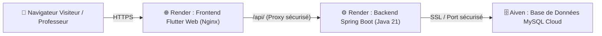

# 🚀 Guide de Déploiement Complet : Aiven (MySQL) & Render (Backend + Frontend)

Ce guide détaille pas à pas la mise en ligne 100 % gratuite de votre application **Casamance Tourisme & Réservations** pour que votre professeur et les jurys puissent tester votre travail en ligne depuis n'importe quel ordinateur ou smartphone.

---

## 🏗️ Architecture Cloud



---

## Étape 1 : Créer la Base de Données MySQL sur Aiven (Gratuit)

Aiven fournit une base de données MySQL 8 managée dans le cloud avec 5 Go de stockage et connexion chiffrée SSL.

1. Rendez-vous sur [aiven.io](https://aiven.io/) et cliquez sur **Start free trial** (ou connectez-vous avec votre compte Google / GitHub).
2. Cliquez sur **Create service**.
3. Choisissez :
   * **Service** : `MySQL`
   * **Cloud provider** : `AWS` (ou `Google Cloud`)
   * **Location** : Choisissez la région la plus proche (ex: `Frankfurt`, `Paris` ou `London`).
   * **Plan** : `Free Plan` (0 $/mois)
   * **Service name** : `casamance-mysql` (ou le nom de votre choix).
4. Cliquez sur **Create service**. Attendez environ 1 à 2 minutes que le statut passe à **Running** (vert).
5. Dans l'onglet **Overview**, repérez la section **Connection information** :
   * **Host** : (ex: `casamance-mysql-xyz.aivencloud.com`)
   * **Port** : (ex: `12345` ou `3306`)
   * **User** : `avnadmin`
   * **Password** : *(Cliquez sur l'icône œil pour copier votre mot de passe)*
   * **Database name** : `defaultdb`

> [!NOTE]
> **Pas besoin d'importer de script SQL !**
> Grâce à `spring.jpa.hibernate.ddl-auto: update` et à notre classe `MsDataInitializer.java`, dès que le backend Spring Boot démarrera sur Render, il créera automatiquement toutes les tables (`patrimoines`, `utilisateurs`, `reservations_mobile`, `avis_mobile`) et insérera les sites touristiques et les comptes de test.

---

## Étape 2 : Déployer le Backend Spring Boot sur Render

Render va compiler et exécuter votre image Docker Java 21 à partir de votre dépôt GitHub.

1. Rendez-vous sur [render.com](https://render.com/) et connectez-vous avec votre compte **GitHub**.
2. Sur votre Dashboard, cliquez sur **New +** > **Web Service**.
3. Sélectionnez votre dépôt GitHub :  
   `Collesyll0607/App_mobile_reservation_visites_touristiques`
4. Configurez les informations suivantes :
   * **Name** : `casamance-backend`
   * **Region** : Choisissez la même région qu'Aiven (ex: `Frankfurt`).
   * **Branch** : `main`
   * **Root Directory** : laissez vide (ou mettez `backend`)
   * **Runtime** : Sélectionnez **`Docker`**
   * **Dockerfile Path** : `backend/Dockerfile`
   * **Docker Build Context** : `backend`
   * **Instance Type** : `Free` (0 $/mois)
5. Déroulez la section **Environment Variables** et cliquez sur **Add Environment Variable** :
   * `SPRING_DATASOURCE_URL` = `jdbc:mysql://<VOTRE_HOST_AIVEN>:<VOTRE_PORT_AIVEN>/defaultdb?ssl-mode=REQUIRED&useSSL=true`
     *(Exemple : `jdbc:mysql://casamance-mysql-xyz.aivencloud.com:12345/defaultdb?ssl-mode=REQUIRED&useSSL=true`)*
   * `SPRING_DATASOURCE_USERNAME` = `avnadmin`
   * `SPRING_DATASOURCE_PASSWORD` = `<VOTRE_MOT_DE_PASSE_AIVEN>`
6. Cliquez sur **Deploy Web Service**.
7. Suivez les logs dans la console Render. En 2 à 3 minutes, vous verrez :
   ```text
   >>> [ms-patrimoine] 5 sites patrimoniaux de Casamance initialisés avec succès dans MySQL !
   Started Application in X seconds
   ==> Your service is live at https://casamance-backend.onrender.com
   ```
8. **Copiez l'URL de votre backend Render** (ex: `https://casamance-backend.onrender.com`).

---

## Étape 3 : Déployer le Frontend Flutter Web sur Render

1. Sur Render, cliquez à nouveau sur **New +** > **Web Service**.
2. Sélectionnez le même dépôt :  
   `Collesyll0607/App_mobile_reservation_visites_touristiques`
3. Configurez les informations :
   * **Name** : `casamance-frontend`
   * **Region** : `Frankfurt`
   * **Branch** : `main`
   * **Runtime** : **`Docker`**
   * **Dockerfile Path** : `Dockerfile`
   * **Docker Build Context** : `.` (racine du projet)
   * **Instance Type** : `Free`
4. Dans **Environment Variables**, ajoutez :
   * `BACKEND_URL` = `https://casamance-backend.onrender.com/api/`  
     *(Remplacez par l'URL exacte obtenue à l'étape 2 avec `/api/` à la fin)*
5. Cliquez sur **Deploy Web Service**.
6. Une fois le déploiement terminé, Render vous donne l'URL finale publique :  
   👉 **`https://casamance-frontend.onrender.com`**

---

## ✅ Vérification et Démonstration pour le Professeur

1. Ouvrez l'URL publique fournie par Render.
2. Tout est actif :
   * **Catalogue** : Les 5 sites de Casamance s'affichent directement depuis la base cloud Aiven.
   * **Réservations** : Vous pouvez effectuer une réservation en ligne (Wave ou sur place).
   * **Espace Guide** : Utilisez le PIN `2026` pour valider les billets en temps réel.
   * **Comptes de test** :
     * `touriste@uasz.sn` / `123456` (Touriste)
     * `guide@uasz.sn` / `123456` (Guide officiel)
